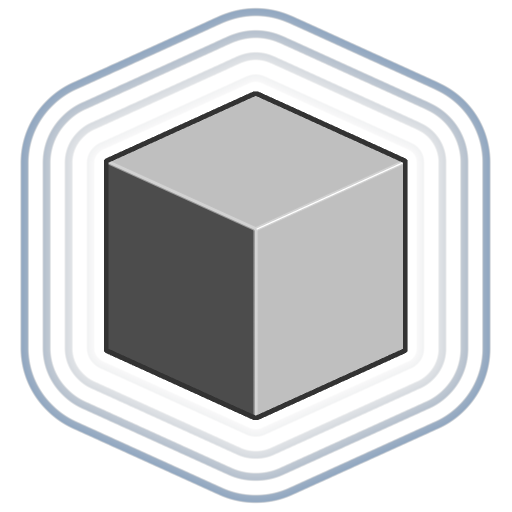

# 立方体

<table>
<tr style="border: 0;">
<td width="33.33%" style="border: 0;" valign="top">

<b>In：</b>SDF 函数>基元

</td>
<td width="100.00%" style="border: 0;" valign="top">

## 描述

立方体的SDF 函数，具有可调整的XYZ大小和边缘的圆化。

</td>
</tr>
</table>

>[!INFO]
> 
> 要了解有关涉及SDF 函数的概念和工作流的更多信息，请转到专用页面： [使用SDF 函数](../../../../../../learning-tutorials/nodes/working-with-sdf-functions/working-with-sdf-functions.md)

## 输入

|  |  |
| :--- | :--- |
| <b>大小</b> *Float3* | X、Y和Z上的多维数据集的大小。  <i>默认值： (1， 1， 1)</i> |
| <b>舍入</b> *Float* | 应用于立方体边缘的圆角弧的半径。  <i>注意：</i>硬边缘可能出现在圆角半径相交的地方。  <i>默认值： 0</i> |
| <b>中心点位置（本地）</b> *Float3* | 立方体的本地透视的世界空间位置，其中(0， 0， 0)将透视放置在立方体的中心。  <i>默认值： (0， 0， -0.5)</i> |
| <b>中心位置</b> *Float3* | 多维数据集的透视世界空间位置。  <i>默认值： (0， 0， 0)</i> |
| <b>P</b> *Float3* | 变换的世界空间位置。 使用此输入可使用<b>偏移P</b>和<b>旋转P</b>节点来应用其他变换。  <i>默认：未变换的世界空间位置。</i> |
