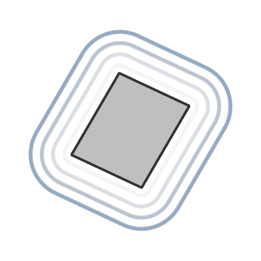

# 平面

<table>
<tr style="border: 0;">
<td width="33.33%" style="border: 0;" valign="top">

<b>In：</b>SDF 函数>基元

</td>
<td width="100.00%" style="border: 0;" valign="top">

## 描述

用于可调整方向、位置和大小的平面的SDF 函数。

</td>
</tr>
</table>

>[!INFO]
> 
> 要了解有关涉及SDF 函数的概念和工作流的更多信息，请转到专用页面： [使用SDF 函数](../../../../../../learning-tutorials/nodes/working-with-sdf-functions/working-with-sdf-functions.md)

## 输入

|  |  |
| :--- | :--- |
| <b>正常</b> *Float3* | 平面的世界空间法线矢量，用于控制其方向。 矢量已规范化。  <i>默认值： (0， 0， 1)</i> |
| <b>大小</b> *Float2* | X和Y中平面的大小。  <i>默认值： (1， 1)</i> |
| <b>Thickness</b> *Float* | 应用于所有方向的平面的Thickness。 当Thickness增加时，平面将四舍五入。  <i>默认值： 0</i> |
| <b>中心位置</b> *Float3* | 平面的世界空间位置。  <i>默认值： (0， 0， 0)</i> |
| <b>P</b> *Float3* | 变换的世界空间位置。 使用此输入可使用<b>偏移P</b>和<b>旋转P</b>节点来应用其他变换。  <i>默认：未变换的世界空间位置。</i> |
