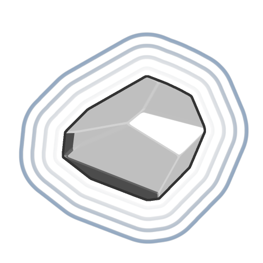

# 岩石

<table>
<tr style="border: 0;">
<td width="33.33%" style="border: 0;" valign="top">

<b>In：</b>SDF 函数>基元

</td>
<td width="100.00%" style="border: 0;" valign="top">

## 描述

一种使用SDF 函数构建的参数化和随机化岩石形状的SDF 函数。

</td>
</tr>
</table>

>[!INFO]
> 
> 要了解有关涉及SDF 函数的概念和工作流的更多信息，请转到专用页面： [使用SDF 函数](../../working-with-sdf-functions.md)

## 输入

|  |  |
| :--- | :--- |
| <b>最大 小平面</b> *整数* | 岩石的最大刻面数（最多32个）。  <i>默认值： 8</i> |
| <b>Smoothness</b> *Float* | 应用于岩石边缘的圆角弧的半径。  <i>默认值： 0</i> |
| <b>随机性</b> *Float* | 脸部方向和到中心的距离。 因此，值越大，岩石越小。  <i>默认值： 0</i> |
| <b>种子</b> *Float* | 为<b>Randomness</b>参数提供种子。  <i>默认值： 0</i> |
| <b>缩放</b> *Float* | 岩石形状的全局缩放。 在<b>随机性</b>之后和<b>Smoothness</b>之前应用。  <i>默认值： 0.5</i> |
| <b>中心位置</b> *Float3* | 岩石轴心的世界空间位置。  <i>默认值： (0， 0， 0.5)</i> |
| <b>P</b> *Float3* | 变换的世界空间位置。 使用此输入可使用<b>偏移P</b>和<b>旋转P</b>节点来应用其他变换。 <i>默认：未变换的世界空间位置。</i> |
