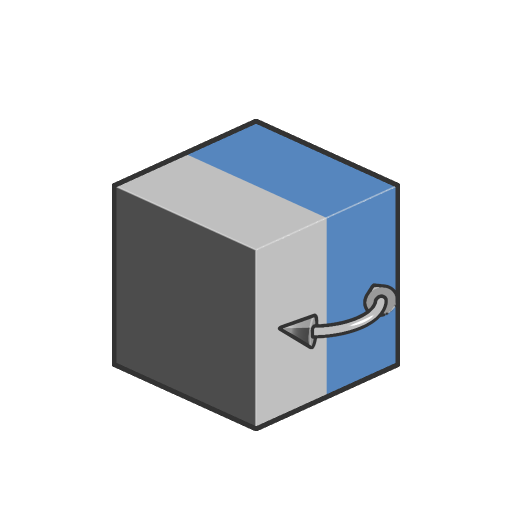

# 水平翻转

<table>
<tr style="border: 0;">
<td width="33.33%" style="border: 0;" valign="top">

<b>进入：</b>SDF 函数>变换

</td>
<td width="100.00%" style="border: 0;" valign="top">

## 描述

将镜像变换应用于输入SDF形状。 实质上在所选轴上执行负缩放。

</td>
</tr>
</table>

>[!INFO]
> 
> 要了解有关涉及SDF 函数的概念和工作流的更多信息，请转到专用页面： [使用SDF 函数](../../../../../../learning-tutorials/nodes/working-with-sdf-functions/working-with-sdf-functions.md)

## 输入

|  |  |
| :--- | :--- |
| <b>SDF</b> *Float* | 输入SDF形状。 |
| <b>镜像轴</b> *整数3* | 使用整数3设置所需的镜像轴。 例如， (1， 0， 0)将镜像X轴。  <i>默认值： (1， 0， 0)</i> |
| <b>P</b> *Float3* | 变换的世界空间位置。 使用此输入可使用<b>偏移P</b>和<b>旋转P</b>节点来应用其他变换。  <i>默认：未变换的世界空间位置。</i> |
