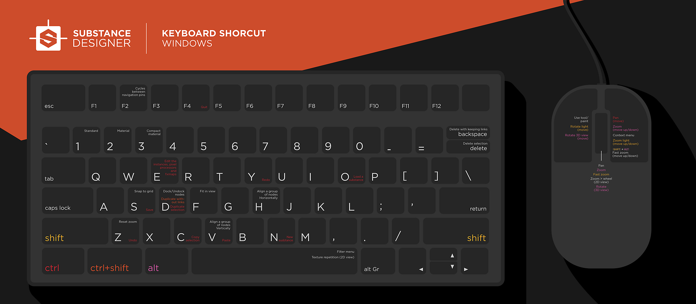
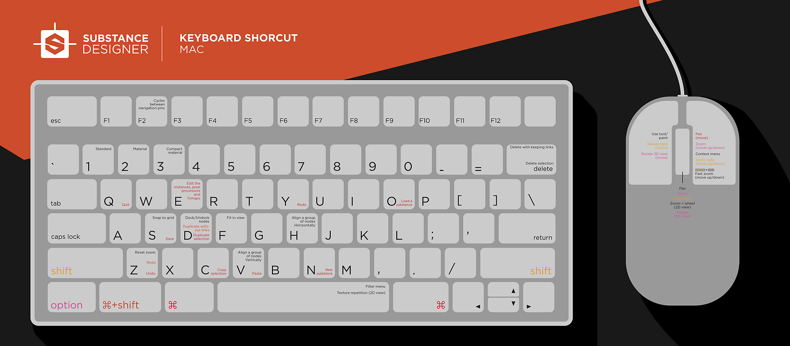

# 快捷键

在此页面上，您可以找到Substance 3D Designer所有快捷键的概述。

## 键图

**Windows**

{zoomable="yes"}

**macOS**

{zoomable="yes"}

## 快捷键列表

### 全球

| 操作 | Windows | macOS |
|:------------------------|:-------------|:-------------|
| 新建 Substance 图形 | Ctrl + N | ⌘ + N |
| 加载包 | Ctrl + O | ⌘ + O |
| 保存包 | Ctrl + S | ⌘ + S |
| 保存所有包 | Ctrl + ⇧ + S | ⌘ + ⇧ + S |
| 还原 | Ctrl + Z | ⌘ + Z |
| 重做 | Ctrl + Y | ⌘ + Y |
| 上下文菜单 | 人民币 | 人民币 |
| 最大化停放 | ⇧ +空格键 | ⇧ +空格键 |
| 切换引擎 | F9 | F9 |
| 暂停引擎 | ⇧ + Escape | ⇧ + Escape |

{style="table-layout:fixed"}

### 图形视图

**视口**

| 操作 | Windows | macOS |
|:----------------------|:---------------------------------------|:-------------------------------------|
| 缩放 | MouseWheel Alt + RMB +拖动 | MouseWheel ⌥ + RMB +拖动 |
| 快速缩放 | ⇧ + MouseWheel ⇧ + Alt + RMB +拖动 | ⇧ + MouseWheel ⇧ + ⌥ + RMB +拖动 |
| 平移 | MMB +拖动 Ctrl + RMB +拖动 | MMB +拖动 ⌘ + RMB +拖动 |
| 重置缩放 | Z | Z |
| 适合视图 | F | F |
| 复制 | Ctrl + C | ⌘ + C |
| 粘贴 | Ctrl + V | ⌘ + V |
| 搜索 | Ctrl + F | ⌘ + F |
| 节点菜单 | 空格键 | 空格键 |
| 循环导航大头针 | F2 | F2 |

{style="table-layout:fixed"}

**建立选区**

| 操作 | Windows | macOS |
|:--------------------------|:-------------------|:---------------|
| 选择添加 | Ctrl + A | ⌘ + A |
| 切换选定项 | Ctrl + LMB | ⌘ + LMB |
| 选框选择（添加） | 按住Ctrl + LMB并拖动 | ⌘ + LMB +拖动 |
| 选框选择(去除) | 按住Shift + LMB并拖动 | ⇧ + LMB +拖动 |

{style="table-layout:fixed"}

**在所选项目上**

| 操作 | Windows | macOS |
|:------------------------------------|:-------------|:----------|
| 复制所选项 | Ctrl + C | ⌘ + C |
| 复制所选项 | Ctrl + D | ⌘ + D |
| 无链接复制 | Ctrl + ⇧ + D | ⌘ + ⇧ + D |
| 删除所选项 | 删除 | 删除 |
| 删除选区并保留链接 | ⌫ | ⌫ |
| 停靠/取消停靠节点 | D | D |
| 适合视图 | F | F |
| 打开引用的图形 | ⌘ + E | ⌘ + C |
| 水平对齐节点 | 高 | 高 |
| 垂直对齐节点 | V | V |
| 将节点捕捉到网格 | S | S |

{style="table-layout:fixed"}

**节点连接**

| 连接器操作 | Windows | macOS |
|:---------------------|:-----------|:--------|
| 移动连接 | ⇧ + LMB | ⇧ + LMB |
| 从同一源新建 | Ctrl + LMB | ⌘ + LMB |
| 删除连接 | Alt + LMB | ⌥ + LMB |

{style="table-layout:fixed"}

| 链接上的操作 | Windows | macOS |
|:---------------------------------|:----------|:--------|
| 切换链接（一次可切换2个链接） | X | X |
| 添加点节点 | Alt + LMB | ⌥ + LMB |

{style="table-layout:fixed"}

#### 仅限图形

| 操作 | Windows | macOS |
|:--------------------------------|:----------|:--------|
| 在2D 视图中快速查看（在节点上） | Alt + LMB | ⌥ + LMB |
| 禁用节点 | ⇧ + D | ⇧ + D |
| 导出图形输出 | Ctrl + B | ⌘ + B |
| 清除节点缓存 | F5 | F5 |
| 取消图形渲染 | Esc | Esc |

{style="table-layout:fixed"}

| 链接创建模式 | Windows | macOS |
|:--------------------|:--------|:------|
| 标准 | 1 | 1 |
| 材质 | 2 | 2 |
| 紧凑材质 | 3 | 3 |

{style="table-layout:fixed"}

>[!NOTE]
>
> 了解本文档的[此页面](../../interface/the-graph-view/link-creation-modes/link-creation-modes.md)中的链接创建模式。

### 2D 视图

| 操作 | Windows | macOS |
|:---------------------|:---------------------------------------|:-------------------------------------|
| 缩放 | MouseWheel Alt + RMB +拖动 | MouseWheel ⌥ + RMB +拖动 |
| 快速缩放 | ⇧ + MouseWheel ⇧ + Alt + RMB +拖动 | ⇧ + MouseWheel ⇧ + ⌥ + RMB +拖动 |
| 平移 | MMB +拖动 Ctrl + RMB +拖动 | MMB +拖动 ⌘ + RMB +拖动 |
| 重置为100%比例 | Z | Z |
| 适合视图 | F | F |
| 切换拼贴显示 | 空格键 | 空格键 |

{style="table-layout:fixed"}

### 3D 视图

| 操作 | Windows | macOS |
|:-----------------------------------------------------|:--------------------------------|:-----------------------------|
| 推拉相机（向前/向后平移） | MouseWheel Alt + RMB +拖动 | MouseWheel ⌥ + RMB +拖动 |
| 轨道相机 | 按住LMB并拖动 | 按住LMB并拖动 |
| 卡车和基座相机（横向和垂直平移） | MMB +拖动 Ctrl + RMB +拖动 | MMB +拖动 ⌘ + RMB +拖动 |
| 旋转环境 | Ctrl + ⇧ + RMB | Ctrl + ⇧ + RMB |
| 临时切换到“点光1”控件 | ⇧（定格） | ⇧（定格） |
| 轨道点光1 | 按住LMB并拖动 | 按住LMB并拖动 |
| 推拉点光1 | RMB +拖动 | RMB +拖动 |
| 保存渲染 | Alt + S | ⌥ + S |
| 将渲染复制到剪贴板 | Alt + C | ⌥ + C |
| 重置相机位置 | R | R |
| 重置相机状态 | ⇧ + R | ⇧ + R |
| 选择网格（仅栅格化工具和GPU 路径追踪） | ⇧ + LMB | ⇧ + LMB |
| 帧选择 | F | F |

{style="table-layout:fixed"}

### 资源管理器

| 操作 | Windows | macOS |
|:----------------------------------|:----------|:-------|
| 关闭所选包 | Ctrl + F4 | ⌘ + W |
| 重新加载包/资源 | Ctrl + R | ⌘ + R |
| 重命名资源 | F2 | F2 |
| 删除资源 | 删除 | 删除 |
| 在编辑器/查看器中加载资源 | 输入 | 输入 |
| Publish将选定包导出到SBSAR | Ctrl + P | ⌘ + P |

{style="table-layout:fixed"}
